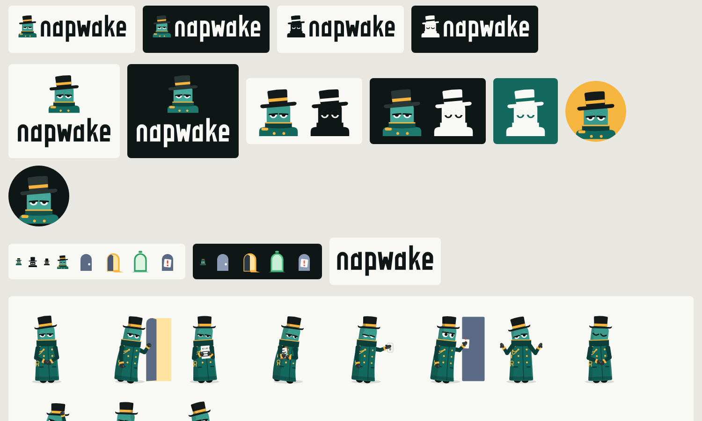

# Napwake brand

The Napwake logo, the night porter, and what you need to show Napwake in a talk, a post or a slide.

| Folder | What | How you may use it |
|---|---|---|
| [`logo/`](logo/) | The Napwake logo, wordmark, mark and avatar, light, dark and one-colour | Unchanged, to refer to Napwake. See [TRADEMARKS.md](TRADEMARKS.md) |
| [`illustrations/`](illustrations/) | The night porter's poses, the door states, scenes and a sticker | Freely, even commercially, with credit, under [CC BY 4.0](illustrations/LICENSE) |

**Credit line for the illustrations:** "Night porter illustrations by Napwake, CC BY 4.0", linked to this repository.

**The doors:** closed and dark is asleep, held ajar with amber light is waking up, open and lit green is awake.

Napwake is open source under Apache 2.0. Neither that licence nor CC BY 4.0 covers the name or the logo; [TRADEMARKS.md](TRADEMARKS.md) does.

Questions, or something you'd like to do that isn't covered here: open an issue.
